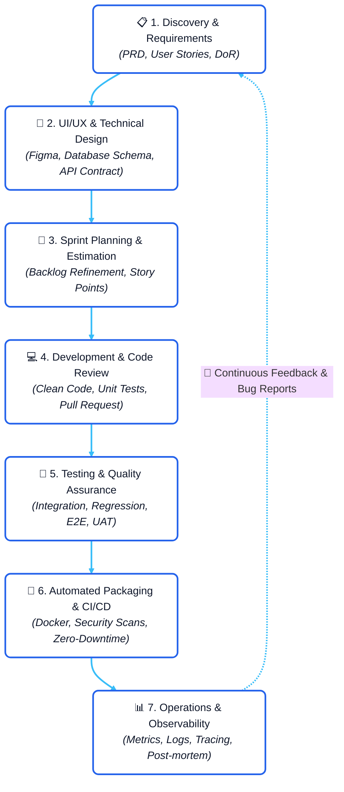
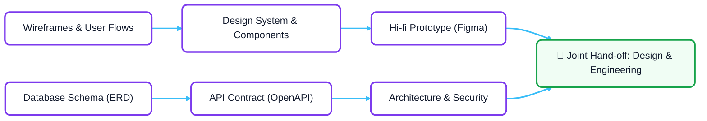
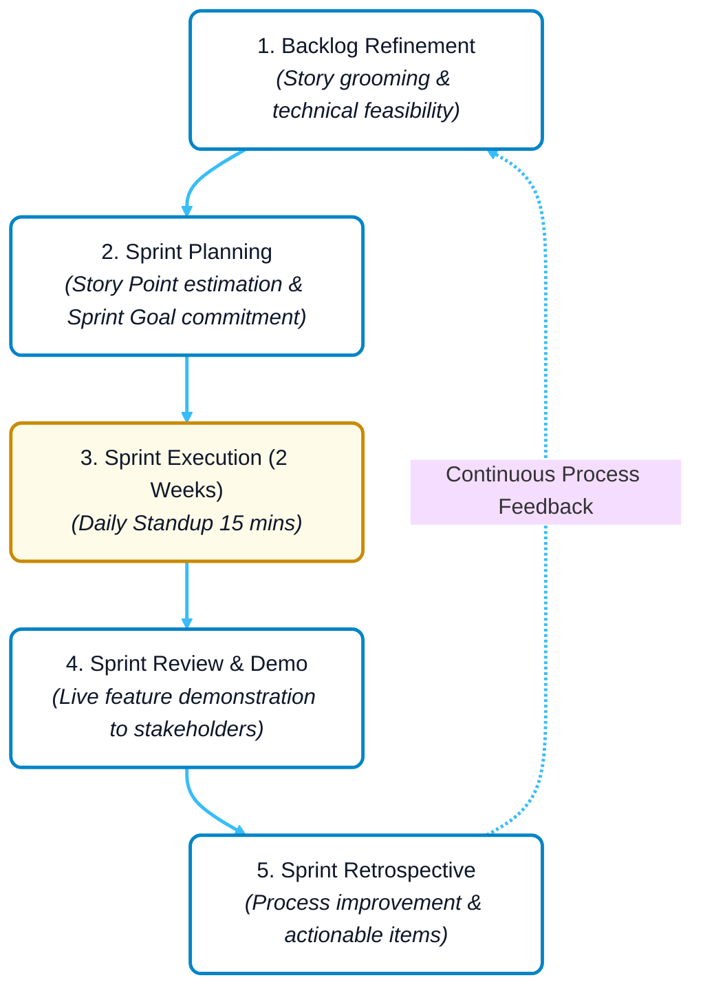
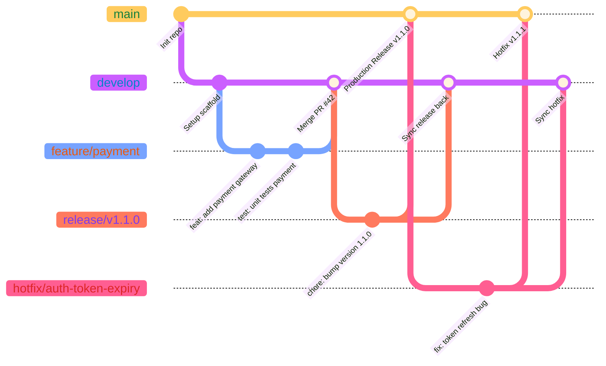
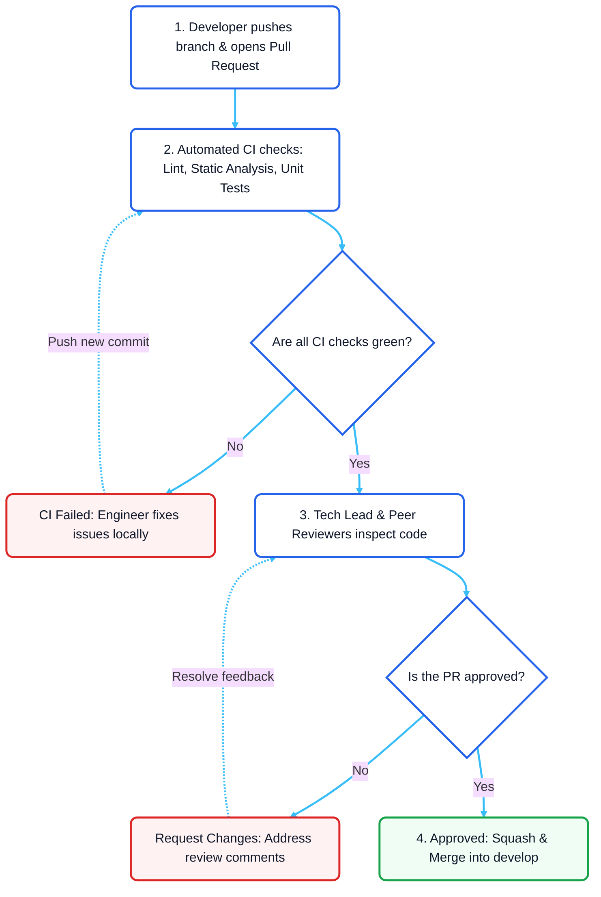
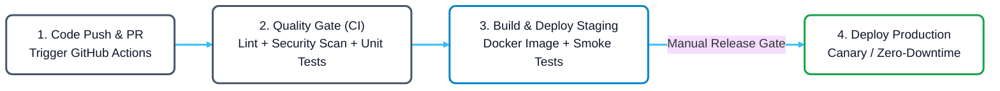
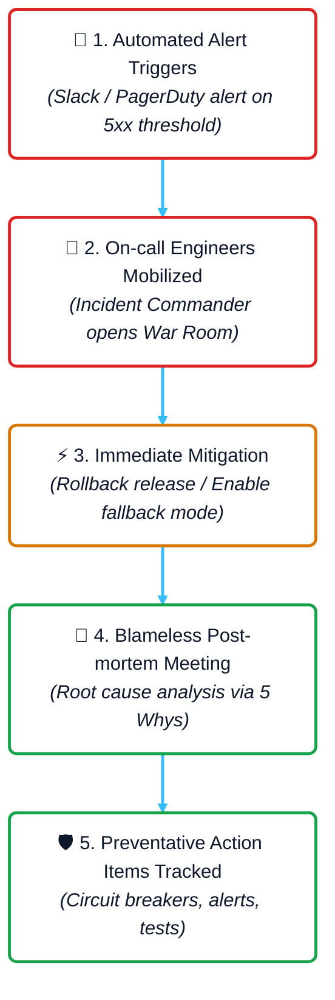

# Comprehensive Report: Professional Software Product Development Lifecycle (SDLC)

A comprehensive guide and industry-standard documentation covering all stages of modern Software Product Development, combining the Agile/Scrum framework with DevOps best practices.

---

## Table of Contents
1. Overview of the Product Development Lifecycle
2. Stage 1: Discovery, Requirement Gathering & Analysis
3. Stage 2: UI/UX Experience Design & Technical Architecture
4. Stage 3: Project Management & Agile/Scrum Sprint Operations
5. Stage 4: Coding Standards, Source Code Management & Code Review
6. Stage 5: Multi-Tier Quality Assurance & Testing Strategies (QA/QC)
7. Stage 6: Automated CI/CD Pipelines & Zero-Downtime Deployment
8. Stage 7: Production Operations, Observability & Incident Management
9. Handover Standards: Definition of Ready (DoR) and Definition of Done (DoD)
10. Key Takeaways & Practical Insights for Software Engineers

---

## 1. Overview of the Product Development Lifecycle

Building a commercial software product involves far more than simply writing code. It requires an orchestrated feedback loop connecting business strategy, product design, engineering, and operations.

---

## 2. Stage 1: Discovery, Requirement Gathering & Analysis

### 2.1. Objectives and Stakeholders
- Primary Objective: Translate business objectives and customer pain points into measurable functional and non-functional engineering requirements.
- Core Team: Product Manager (PM), Product Owner (PO), Business Analyst (BA), Technical Lead.

### 2.2. Product Requirement Document (PRD)
A production-grade PRD contains the following sections:
- Executive Summary and Business Context: What problem does this solve, and what value does it deliver to the end user?
- Measurable Success Metrics (KPIs / OKRs): E.g., increase checkout conversion by 12%, reduce average page load time below 1.2 seconds.
- Scope Management (In-scope vs. Out-of-scope): Defines strict boundaries to prevent scope creep during sprint execution.
- User Journeys and System Business Flowcharts.

### 2.3. User Story and Acceptance Criteria (AC) Standards
- Standard User Story Template:
  `As a [user role], I want to [perform an action], so that [achieve a specific business outcome].`
  Example: As a registered customer, I want to save items to my wishlist, so that I can easily review and purchase them later.
- Acceptance Criteria using the Given - When - Then format:
  - Given: Initial system state (e.g., The user is authenticated and viewing a product card).
  - When: Trigger action (e.g., The user clicks the wishlist heart icon).
  - Then: Expected outcome (e.g., The heart turns red, counter increments by 1, and an alert displays Saved to Wishlist).

---

## 3. Stage 2: UI/UX Experience Design & Technical Architecture

### 3.1. Product Design (UI/UX)
- Information Architecture: Establishes navigation hierarchy and intuitive layout structure.
- Design System: Standardizes color tokens, typography, component states, and responsive grids to maintain consistency across web and mobile.
- Usability Testing: Conducted on interactive Figma prototypes with target users prior to engineering commitment.

### 3.2. Technical Design Document (TDD)
Before writing code for major epics, the Tech Lead or Senior Engineer writes a TDD covering:
- Database Schema (ERD): Entities, normalization, foreign keys, compound indexes, and query performance considerations.
- API Contract First: Documented in OpenAPI 3.0 / Swagger:
  - Resource endpoints, HTTP verbs (GET, POST, PUT, PATCH, DELETE).
  - Structured request body, query parameters, authentication headers.
  - Success responses (200, 201) and error responses (400, 401, 403, 404, 422, 500).
- System Architecture Decisions:
  - Service decomposition (Monolithic modularity vs. Microservices).
  - Caching strategy (Redis for hot data, TTL invalidation policies).
  - Asynchronous event bus (RabbitMQ, Apache Kafka, AWS SQS).

---

## 4. Stage 3: Project Management & Agile/Scrum Sprint Operations

Modern development teams run in focused cycles called Sprints (typically lasting 2 to 3 weeks):

### 4.1. Core Scrum Ceremonies
1. Backlog Refinement: Mid-sprint grooming to clarify acceptance criteria and break down upcoming stories.
2. Sprint Planning: The team estimates complexity using Story Points (Fibonacci: 1, 2, 3, 5, 8, 13) and locks in the Sprint Goal.
3. Daily Standup: A synchronous 15-minute sync where each engineer answers:
   - What did I complete yesterday?
   - What am I committing to today?
   - Are there any blockers or technical dependencies?
4. Sprint Review / Demo: Showcasing real working software to stakeholders at the close of the sprint.
5. Sprint Retrospective: An internal reflection examining What went well, What needs improvement, and concrete Action Items for the next sprint.

---

## 5. Stage 4: Coding Standards, Source Code Management & Code Review

### 5.1. Enterprise Gitflow Branching Strategy

- Branch Naming Conventions:
  - `feature/[ticket-id]-[short-desc]`: For new feature work (e.g., `feature/JIRA-101-cart-checkout`).
  - `bugfix/[ticket-id]-[short-desc]`: For non-critical bug fixes during sprint development.
  - `hotfix/[version]`: Urgent fixes patched directly against `main` for production defects.
  - `release/[version]`: Feature freeze branch for final QA regression and staging validation.

### 5.2. Conventional Commits Standard
Commit messages adhere strictly to standard format: `<type>(<scope>): <subject>`
- `feat`: A new feature introduced into the codebase.
- `fix`: A bug fix.
- `docs`: Documentation-only updates.
- `refactor`: Code changes that neither fix a bug nor add a feature.
- `test`: Adding or correcting tests.
- `chore`: Build tooling, dependency upgrades, or configuration adjustments.

### 5.3. Peer Code Review Lifecycle

---

## 6. Stage 5: Multi-Tier Quality Assurance & Testing Strategies (QA/QC)

### 6.1. The Testing Pyramid
A robust automated testing strategy balances speed, cost, and reliability:
1. Unit Tests (Base Layer - Highest Volume):
   - Written by developers to isolate functions, classes, and domain logic.
   - Executes in milliseconds; target line coverage typically ranges between 70% and 80%.
2. Integration Tests (Middle Layer):
   - Verifies interaction across module boundaries: Service to Database, Service to Cache, API to Message Queue.
   - Utilizes containerized dependencies via Testcontainers.
3. End-to-End (E2E) & UI Tests (Top Layer - Targeted Volume):
   - Automated with frameworks like Playwright or Cypress.
   - Simulates real customer journeys: Login -> Add to Cart -> Checkout -> Payment Confirmation.

### 6.2. Bug Life Cycle Workflow

```mermaid
%%{init: {'theme': 'base', 'themeVariables': { 'fontFamily': 'sans-serif' }}}%%
flowchart LR
    classDef newBug fill:#ffffff,stroke:#dc2626,stroke-width:2.5px,color:#0f172a,rx:6px,ry:6px
    classDef inProg fill:#ffffff,stroke:#d97706,stroke-width:2.5px,color:#0f172a,rx:6px,ry:6px
    classDef verify fill:#ffffff,stroke:#0284c7,stroke-width:2.5px,color:#0f172a,rx:6px,ry:6px
    classDef closed fill:#ffffff,stroke:#16a34a,stroke-width:2.5px,color:#0f172a,rx:6px,ry:6px

    B1["🐞 1. Defect Logged<br/><i>(Steps to reproduce & logs)</i>"]:::newBug
    B2["🛠️ 2. In Progress<br/><i>(Root cause fix & unit tests)</i>"]:::inProg
    B3["🔍 3. QA Recheck<br/><i>(Verify on Staging)</i>"]:::verify
    B4["✅ 4. Closed<br/><i>(Resolved & Verified)</i>"]:::closed

    B1 ==> B2
    B2 ==> B3
    B3 ==>|"Passed"| B4
    B3 -.->|"Defect Persists (Reopen)"| B2

    linkStyle default stroke:#38bdf8,stroke-width:2.5px;
```

---

## 7. Stage 6: Automated CI/CD Pipelines & Zero-Downtime Deployment

### 7.1. CI/CD Pipeline Architecture

1. Continuous Integration (CI):
   - Code Quality & Formatting: Enforced with ESLint and Prettier.
   - Static Application Security Testing (SAST): Scanned with SonarQube and dependency vulnerability scanners (Trivy, Snyk).
   - Automated Test Execution: Any failed unit or integration test immediately blocks the pipeline.
   - Container Image Build: Generates an immutable, versioned Docker image published to a secure Container Registry.

2. Continuous Delivery / Deployment (CD):
   - Development Environment: Continuously deployed from the `develop` branch for rapid verification.
   - Staging Environment (Pre-production): Mirrors production infrastructure, configuration, and scale. Used for final QA regression and stakeholder sign-off.
   - Production Environment: The live, customer-facing system.

### 7.2. Modern Zero-Downtime Deployment Strategies
- Blue/Green Deployment: Two identical production environments exist. Blue serves live traffic while Green receives the new release. Following smoke test verification, the router instantly flips traffic to Green.
- Canary Releases: The new version is exposed to a small subset of users (5% - 10%). Health metrics and error rates are monitored closely before rolling out to 100% of the fleet.
- Rolling Updates: Orchestrated via Kubernetes, updating pods incrementally to ensure zero service disruption.

---

## 8. Stage 7: Production Operations, Observability & Incident Management

### 8.1. The Three Pillars of Observability
1. Metrics (Numerical Measurements):
   - Infrastructure indicators: CPU utilization, Memory pressure, Disk I/O, Network saturation.
   - Application health (The RED Method): Request Rate, Error Rate (HTTP 5xx), and Latency Duration (P95, P99).
   - Tooling: Prometheus, Grafana, Datadog.
2. Logs (Structured Event Records):
   - Centralized aggregation across distributed microservices.
   - Formatted in structured JSON including `correlation_id` / `trace_id` for end-to-end request stitching.
   - Tooling: ElasticSearch, Logstash, Kibana (ELK) or Grafana Loki.
3. Distributed Tracing:
   - Tracks requests as they propagate across service boundaries: API Gateway -> Auth Service -> Inventory Service -> Database.
   - Identifies high-latency bottlenecks and inter-service failure points.
   - Tooling: OpenTelemetry, Jaeger, AWS X-Ray.

### 8.2. Incident Response Workflow & Blameless Post-mortem

- Incident Severity Classification:
  - P1 (Critical): Total service outage impacting revenue or data integrity. SLA response time: < 15 minutes.
  - P2 (Major): Core functional impairment with high customer impact, but workarounds exist.
  - P3 (Minor): Partial degradation affecting a small percentage of requests without systemic failure.
- Blameless Post-mortem Culture:
  - Focuses on systemic and procedural vulnerabilities rather than attributing human blame.
  - Employs the 5 Whys methodology to uncover root causes and prevent recurrence.

---

## 9. Handover Standards: Definition of Ready (DoR) and Definition of Done (DoD)

To eliminate ambiguity across engineering and product teams, two formal contracts are established:

### 9.1. Definition of Ready (DoR) - Entrance Criteria for Development
A User Story may only be accepted into an active Sprint Backlog when:
- The business objective and user value are clearly articulated.
- Acceptance Criteria are clearly stated in Given-When-Then format.
- UI/UX mockups and interactive components are approved in Figma.
- API contracts are agreed upon between Frontend and Backend leads.
- The story has been sized and estimated in Story Points by the team.

### 9.2. Definition of Done (DoD) - Exit Criteria for Completion
A feature is only considered Done and ready for release when:
- Code is fully written and passes peer review with at least one approval.
- Unit and integration tests pass with required code coverage maintained.
- All automated CI pipeline checks complete successfully.
- Deployed and verified on the Staging environment.
- QA validates all test scenarios and signs off with zero critical defects.
- Public API documentation (Swagger/OpenAPI) and release notes are updated.

---

## 10. Key Takeaways & Practical Insights for Software Engineers

1. Code Quality Is One Part of the Equation: Writing clean algorithms is essential, but understanding user requirements, architectural constraints, and operational dependencies determines overall product success.
2. Shift-Left Testing Protects Velocity: Catching bugs early via automated unit tests and linters is exponentially cheaper than discovering regressions in production.
3. Transparent & Proactive Communication: Surface impediments and blockers early during Daily Standup meetings rather than waiting until sprint deadlines loom.
4. Professional Rigor in Version Control: Structured commit messages, focused pull requests, and respectful, constructive code reviews demonstrate engineering maturity.
