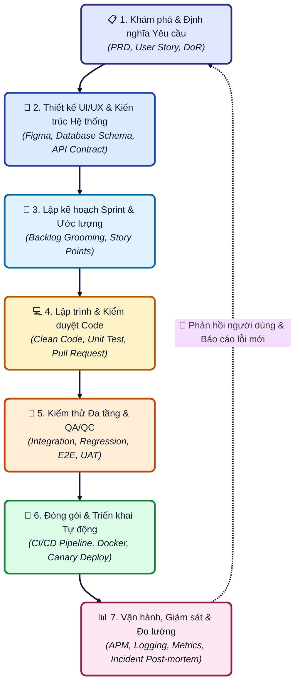
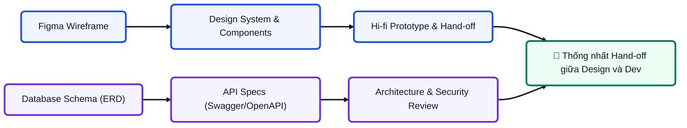
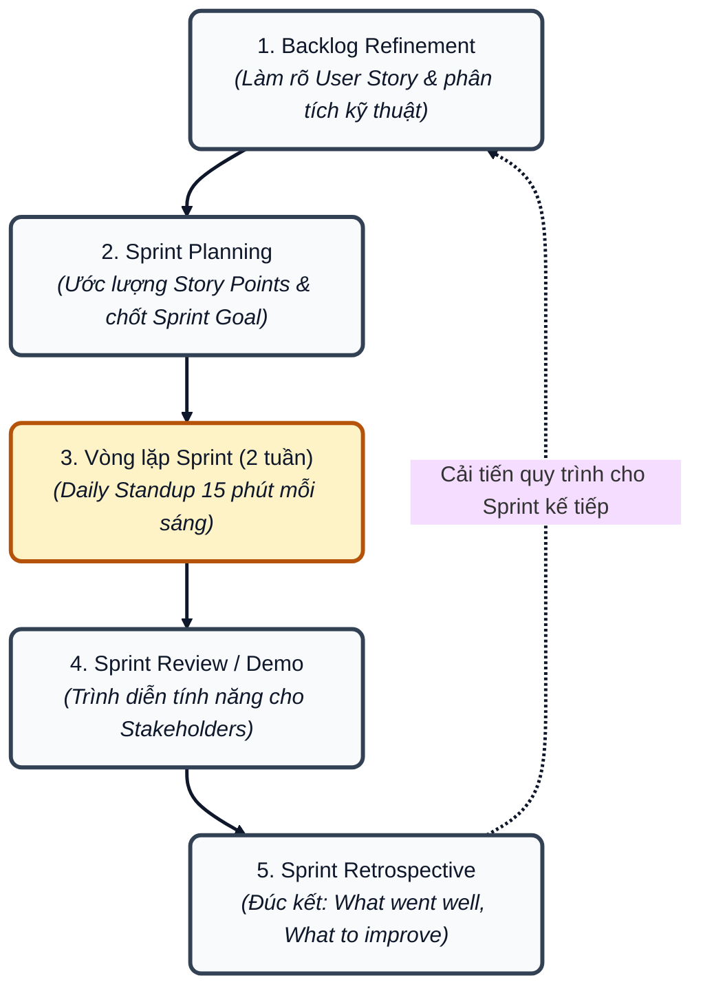
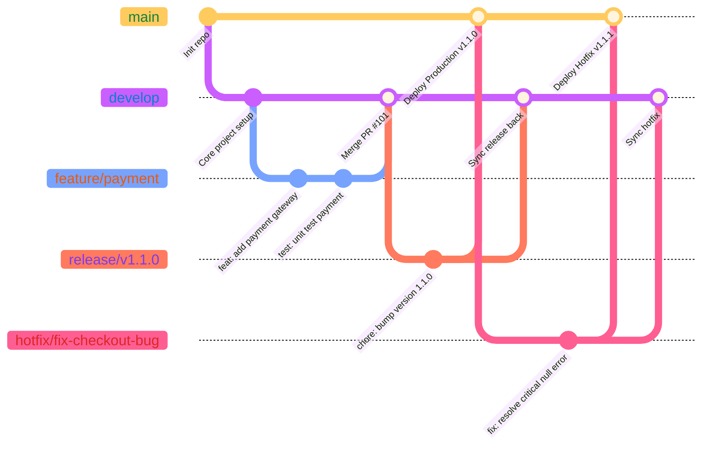
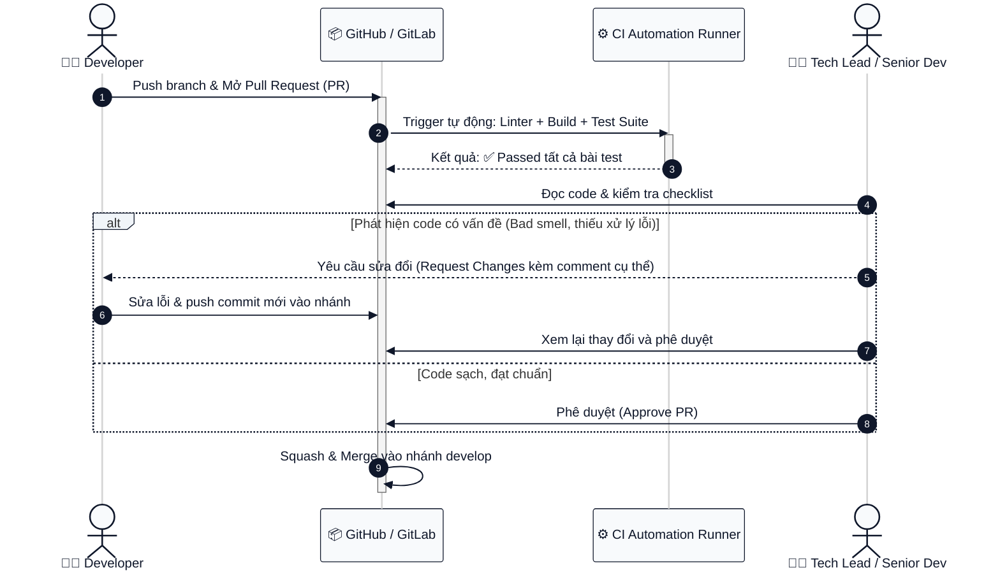
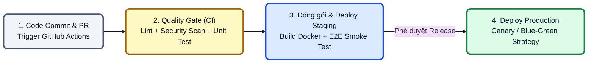
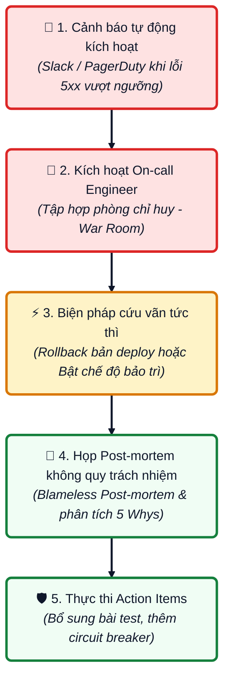

# Báo Cáo Tìm Hiểu: Quy Trình Phát Triển Sản Phẩm Phần Mềm Chuyên Nghiệp

Tài liệu chi tiết phục vụ báo cáo thực tập, tổng hợp toàn diện các giai đoạn chuẩn trong vòng đời phát triển phần mềm (SDLC - Software Development Life Cycle), áp dụng khung làm việc Agile/Scrum kết hợp văn hóa thực hành DevOps hiện đại tại các doanh nghiệp công nghệ.

---

## Mục Lục
1. Tổng quan Vòng đời Phát triển Sản phẩm (SDLC)
2. Giai đoạn 1: Khám phá, Phân tích & Định nghĩa Yêu cầu
3. Giai đoạn 2: Thiết kế Trải nghiệm (UI/UX) & Kiến trúc Kỹ thuật (Technical Design)
4. Giai đoạn 3: Quản lý Dự án & Vận hành Sprint theo Agile/Scrum
5. Giai đoạn 4: Quy chuẩn Lập trình, Quản lý Mã nguồn & Code Review
6. Giai đoạn 5: Chiến lược Đảm bảo Chất lượng & Kiểm thử Đa tầng (QA/QC)
7. Giai đoạn 6: Tự động hóa CI/CD & Chiến lược Triển khai Zero-Downtime
8. Giai đoạn 7: Vận hành, Giám sát (Observability) & Quản lý Sự cố (Incident Management)
9. Tiêu chuẩn Bàn giao: Definition of Ready (DoR) và Definition of Done (DoD)
10. Tổng kết & Bài học Thực tập

---

## 1. Tổng quan Vòng đời Phát triển Sản phẩm (SDLC)

Một sản phẩm phần mềm chuyên nghiệp không chỉ dừng lại ở việc viết mã code mà là một chuỗi quy trình liên kết chặt chẽ giữa kinh doanh, thiết kế, kỹ thuật và vận hành. Quy trình chuẩn được vận hành theo một vòng lặp kín (feedback loop), đảm bảo sản phẩm liên tục được tối ưu và cải tiến dựa trên dữ liệu thực tế.

Biểu đồ luồng chi tiết các giai đoạn liên kết:

---

## 2. Giai đoạn 1: Khám phá, Phân tích & Định nghĩa Yêu cầu

### 2.1. Mục tiêu và Vai trò
- Mục tiêu: Chuyển hóa mục tiêu kinh doanh (Business Goals) và nỗi đau của người dùng (User Pain Points) thành các yêu cầu chức năng (Functional Requirements) và phi chức năng (Non-functional Requirements) cụ thể.
- Nhân sự tham gia: Product Manager (PM), Product Owner (PO), Business Analyst (BA), Tech Lead.

### 2.2. Tài liệu Yêu cầu Sản phẩm (PRD - Product Requirement Document)
Một bản PRD hoàn chỉnh bao gồm các thành phần:
- Bối cảnh và mục tiêu dự án: Giải quyết vấn đề gì, mang lại giá trị gì cho khách hàng và doanh nghiệp.
- Chỉ số thành công đo lường được (Success Metrics / KPIs): Ví dụ tăng tỷ lệ chuyển đổi thêm 15%, giảm thời gian tải trang xuống dưới 1.5 giây.
- Phạm vi dự án (In-scope và Out-of-scope): Nêu rõ những gì làm và những gì không làm trong phiên bản hiện tại để tránh phình to phạm vi (Scope Creep).
- Luồng người dùng (User Flow) và Sơ đồ nghiệp vụ (Business Flowchart).

### 2.3. Quy chuẩn viết User Story và Tiêu chí Chấp nhận (Acceptance Criteria)
- Cấu trúc User Story tiêu chuẩn:
  `Là một [vai trò người dùng], tôi muốn [thực hiện hành động], để [nhận được giá trị cụ thể].`
  Ví dụ: Là một khách hàng mua sắm, tôi muốn lưu sản phẩm vào danh sách yêu thích, để tôi có thể xem lại và mua sau mà không mất công tìm kiếm.
- Tiêu chí chấp nhận theo định dạng Given - When - Then:
  - Given: Điều kiện tiền đề (Ví dụ: Người dùng đã đăng nhập vào hệ thống).
  - When: Hành động xảy ra (Ví dụ: Người dùng bấm vào biểu tượng hình trái tim trên thẻ sản phẩm).
  - Then: Kết quả mong đợi (Ví dụ: Trái tim đổi màu đỏ, số lượng yêu thích tăng 1, thông báo Lưu thành công hiển thị trong 3 giây).

---

## 3. Giai đoạn 2: Thiết kế Trải nghiệm (UI/UX) & Kiến trúc Kỹ thuật

### 3.1. Thiết kế Trải nghiệm Sản phẩm (Product Design)
- Wireframing & Information Architecture: Xây dựng khung xương cấu trúc thông tin và luồng thao tác.
- Design System: Chuẩn hóa bảng màu, typography, khoảng cách (spacing), component tái sử dụng (button, input, modal) nhằm đảm bảo giao diện đồng nhất trên toàn hệ thống.
- Hi-fi Interactive Prototype: Tạo bản thiết kế tương tác trên Figma để người dùng trải nghiệm thử và lấy ý kiến kiểm chứng (Usability Testing) trước khi viết code.

### 3.2. Thiết kế Kiến trúc Kỹ thuật (Technical Design Document - TDD)
Trước khi lập trình tính năng lớn, Tech Lead/Senior Developer phải viết tài liệu TDD bao gồm:
- Thiết kế cơ sở dữ liệu (Database Schema / ERD): Xác định các bảng/collection, trường dữ liệu, khóa chính, khóa ngoại, chỉ mục (indexes) để tối ưu truy vấn.
- Thỏa thuận API Contract (API Specification): Sử dụng chuẩn OpenAPI/Swagger để mô tả chi tiết:
  - Endpoint URL, HTTP Methods (GET, POST, PUT, PATCH, DELETE).
  - Cấu trúc Headers, Request Body, Query Params.
  - Cấu trúc Response thành công (200, 201) và các mã lỗi chi tiết (400, 401, 403, 404, 422, 500).
- Quyết định công nghệ và mô hình kiến trúc:
  - Chọn Monolith hay Microservices dựa trên quy mô đội ngũ và bài toán chịu tải.
  - Chiến lược bộ nhớ đệm (Caching với Redis).
  - Xử lý hàng đợi bất đồng bộ (Message Broker: RabbitMQ hoặc Apache Kafka).

---

## 4. Giai đoạn 3: Quản lý Dự án & Vận hành Sprint theo Agile/Scrum

Quy trình phát triển phần mềm hiện đại thường chia thành các chu kỳ ngắn hạn gọi là Sprint (thường kéo dài từ 2 đến 3 tuần):

### 4.1. Các Lễ nghi Scrum (Scrum Ceremonies)
1. Backlog Refinement (Grooming): Diễn ra giữa sprint để Product Owner và đội kỹ thuật rà soát, giải đáp thắc mắc, phân rã task cho sprint tiếp theo.
2. Sprint Planning: Diễn ra vào đầu sprint. Đội ngũ thảo luận độ phức tạp bằng Story Points (dãy số Fibonacci: 1, 2, 3, 5, 8, 13) và cam kết mục tiêu Sprint Goal.
3. Daily Standup: Cuộc họp ngắn 15 phút mỗi ngày, mỗi thành viên trả lời 3 câu hỏi:
   - Hôm qua tôi đã hoàn thành những gì?
   - Hôm nay tôi sẽ làm những gì?
   - Tôi có gặp khó khăn hay vướng mắc (blockers/impediments) nào cần hỗ trợ không?
4. Sprint Review & Demo: Buổi trình diễn sản phẩm chạy thực tế cho các bên liên quan (Stakeholders) nghiệm thu vào cuối sprint.
5. Sprint Retrospective: Buổi nhìn nhận nội bộ đội ngũ với 3 góc nhìn:
   - Những điều đã làm tốt cần duy trì.
   - Những điểm còn hạn chế gây tắc nghẽn.
   - Hành động cải tiến cụ thể (Action Items) cho sprint sau.

---

## 5. Giai đoạn 4: Quy chuẩn Lập trình, Quản lý Mã nguồn & Code Review

### 5.1. Mô hình Phân nhánh Gitflow Chuẩn Doanh nghiệp

- Quy ước đặt tên nhánh:
  - `feature/[tên-chức-năng]`: Nhánh phát triển tính năng mới (ví dụ: `feature/user-profile`).
  - `bugfix/[mã-ticket]`: Nhánh sửa lỗi phát sinh trong sprint (ví dụ: `bugfix/JIRA-342-login-redirect`).
  - `hotfix/[phiên-bản]`: Nhánh sửa lỗi khẩn cấp trực tiếp từ `main` trên production.
  - `release/[phiên-bản]`: Nhánh đóng băng tính năng để QA kiểm thử toàn diện trước khi phát hành.

### 5.2. Quy chuẩn Viết Commit (Conventional Commits)
Thông điệp commit phải tuân thủ định dạng chuẩn để tự động tạo Changelog:
`<loại>(<phạm vi>): <mô tả ngắn>`
- `feat`: Thêm tính năng mới (Ví dụ: `feat(auth): add google oauth login`).
- `fix`: Sửa lỗi (Ví dụ: `fix(cart): prevent negative quantity on update`).
- `docs`: Cập nhật tài liệu kỹ thuật (Ví dụ: `docs: update api swagger documentation`).
- `refactor`: Tái cấu trúc code nhưng không thay đổi hành vi bên ngoài.
- `test`: Viết thêm hoặc sửa đổi unit/integration test.
- `chore`: Cập nhật cấu hình thư viện, build tool.

### 5.3. Quy trình Kiểm duyệt Mã nguồn (Code Review)

- Checklist cần kiểm tra khi Code Review:
  1. Tính đúng đắn: Code có đáp ứng đúng tất cả tiêu chí Acceptance Criteria không?
  2. Xử lý trường hợp biên (Edge cases): Dữ liệu rỗng, dữ liệu cực lớn, timeout, kết nối mạng lỗi.
  3. Bảo mật: Không hardcode API key, password, token; kiểm tra lỗ hổng SQL Injection, XSS, CSRF.
  4. Hiệu năng: Tránh truy vấn N+1 vào cơ sở dữ liệu, tránh rò rỉ bộ nhớ (memory leak).
  5. Độ sạch (Clean Code): Đặt tên biến/hàm có ý nghĩa, tuân thủ nguyên lý SOLID, viết hàm nhỏ gọn phục vụ duy nhất một trách nhiệm (Single Responsibility).
  6. Kiểm thử: Đã có Unit Test bao phủ các nhánh logic chính chưa?

---

## 6. Giai đoạn 5: Chiến lược Đảm bảo Chất lượng & Kiểm thử Đa tầng (QA/QC)

### 6.1. Kim tự tháp Kiểm thử (Testing Pyramid)
Một hệ sinh thái kiểm thử hiệu quả tuân theo cấu trúc phân tầng:
1. Unit Tests (Tầng đáy - Số lượng nhiều nhất):
   - Do lập trình viên viết, kiểm thử các đơn vị nhỏ nhất (hàm, phương thức, class).
   - Chạy siêu nhanh (vài giây), chi phí duy trì thấp.
   - Thước đo: Độ bao phủ mã nguồn (Code Coverage) đạt từ 70% đến 80%.
2. Integration Tests (Tầng giữa):
   - Kiểm tra sự tương tác giữa các module: Service gọi Database, API gọi dịch vụ thanh toán ngoài.
   - Sử dụng Testcontainers hoặc môi trường mock để kiểm thử.
3. End-to-End Tests & UI Tests (Tầng trên cùng - Số lượng vừa phải):
   - Sử dụng các công cụ tự động hóa như Playwright, Cypress, Selenium.
   - Giả lập trọn vẹn hành vi của người dùng từ giao diện: Đăng nhập -> Chọn hàng -> Thanh toán -> Nhận email.
   - Chạy chậm, tốn nhiều tài nguyên nhưng mang lại độ tin cậy thực tế cao.

### 6.2. Vòng đời Xử lý Lỗi (Bug Life Cycle)

```mermaid
%%{init: {'theme': 'base', 'themeVariables': { 'fontFamily': 'sans-serif' }}}%%
flowchart LR
    classDef newBug fill:#fee2e2,stroke:#dc2626,stroke-width:3px,color:#0f172a,rx:6px,ry:6px
    classDef devFix fill:#fef3c7,stroke:#d97706,stroke-width:3px,color:#0f172a,rx:6px,ry:6px
    classDef qaCheck fill:#e0f2fe,stroke:#0284c7,stroke-width:3px,color:#0f172a,rx:6px,ry:6px
    classDef doneBug fill:#dcfce7,stroke:#16a34a,stroke-width:3px,color:#0f172a,rx:6px,ry:6px

    B1["🐞 1. Phát hiện lỗi<br/><i>(Tạo ticket Jira với steps to reproduce)</i>"]:::newBug
    B2["🛠️ 2. Dev nhận task<br/><i>(Điều tra nguyên nhân & viết bugfix)</i>"]:::devFix
    B3["🔍 3. QA kiểm thử lại<br/><i>(Kiểm tra bản fix trên Staging)</i>"]:::qaCheck
    B4["✅ 4. Đóng lỗi<br/><i>(Verified & Closed)</i>"]:::doneBug

    B1 ==> B2
    B2 ==> B3
    B3 ==>|"Đạt yêu cầu"| B4
    B3 -.->|"Vẫn còn lỗi (Reopen)"| B2

    linkStyle default stroke:#0f172a,stroke-width:2.5px;
```

- Tiêu chuẩn tạo một Bug Ticket chuyên nghiệp trên Jira/Linear:
  - Tóm tắt lỗi (Title): Ngắn gọn, nêu bật bản chất lỗi.
  - Các bước tái hiện (Steps to Reproduce): Đánh số thứ tự từng bước cụ thể từ lúc mở app đến khi xảy ra lỗi.
  - Kết quả thực tế (Actual Result): Mô tả chuyện gì đã xảy ra kèm screenshot/video và log lỗi.
  - Kết quả kỳ vọng (Expected Result): Đáng lẽ hệ thống phải xử lý như thế nào.
  - Môi trường phát sinh (Environment): Hệ điều hành, phiên bản trình duyệt, kích thước màn hình, tài khoản test.
  - Mức độ nghiêm trọng (Severity): Blocker, Critical, Major, Minor, Trivial.

---

## 7. Giai đoạn 6: Tự động hóa CI/CD & Chiến lược Triển khai Zero-Downtime

### 7.1. Chuỗi Pipeline Tích hợp và Triển khai Liên tục (CI/CD Pipeline)

1. Continuous Integration (CI):
   - Chạy tự động mỗi khi có commit hoặc Pull Request mới.
   - Linting & Formatting: Kiểm tra style code với ESLint, Prettier.
   - Static Code Analysis & Security Scanning: Quét chất lượng code và nợ kỹ thuật bằng SonarQube, quét lỗ hổng thư viện phụ thuộc bằng Snyk/Trivy.
   - Automated Testing: Thực thi toàn bộ Unit Test và Integration Test. Nếu có bất kỳ bài test nào thất bại, pipeline bị chặn ngay lập tức.
   - Build Artifact: Đóng gói ứng dụng thành Docker Container Image chuẩn và đẩy vào Container Registry (Docker Hub, AWS ECR, GCP Artifact Registry).

2. Continuous Delivery / Deployment (CD):
   - Môi trường Development (Dev): Triển khai tự động ngay khi merge code vào nhánh develop để đội ngũ kiểm tra nhanh.
   - Môi trường Staging (Pre-production): Có cấu hình phần cứng, dữ liệu mẫu và các kết nối mô phỏng tương đương 99% môi trường thật. Nơi QA thực hiện nghiệm thu UAT cuối cùng.
   - Môi trường Production (Prod): Hệ thống chạy thực tế phục vụ khách hàng.

### 7.2. Các Chiến lược Phát hành Không Gián đoạn (Zero-Downtime Deployment)
- Blue/Green Deployment: Duy trì 2 môi trường Production giống hệt nhau (Blue là bản đang chạy, Green là bản mới). Khi Green khởi động thành công và vượt qua smoke test, Load Balancer (Nginx/AWS ALB) chuyển hướng 100% traffic từ Blue sang Green tức thì. Nếu có sự cố, chuyển ngược lại trong vài giây.
- Canary Deployment: Ban đầu chỉ điều hướng một tỷ lệ nhỏ người dùng (5% - 10%) sang cụm máy chủ phiên bản mới. Hệ thống giám sát tỷ lệ lỗi (Error Rate) và độ trễ (Latency). Nếu mọi chỉ số ổn định, tăng dần tỷ lệ lên 25%, 50%, 100%.
- Rolling Update: Cập nhật từng pod/instance container tuần tự cho đến khi toàn bộ cụm máy chủ (Kubernetes cluster) chạy phiên bản mới.

---

## 8. Giai đoạn 7: Vận hành, Giám sát (Observability) & Quản lý Sự cố

### 8.1. Ba Trụ cột của Hệ thống Giám sát (Observability Pillars)
1. Metrics (Chỉ số số học):
   - Theo dõi tài nguyên hạ tầng: CPU usage, RAM utilization, Disk I/O, Network in/out.
   - Theo dõi chỉ số ứng dụng (RED Method): Rate (Số request/giây), Errors (Tỷ lệ lỗi 5xx), Duration (Thời gian phản hồi P95, P99).
   - Công cụ: Prometheus, Grafana, Datadog.
2. Logs (Nhật ký sự kiện):
   - Gom log tập trung từ tất cả các microservices về một nơi để tìm kiếm và phân tích.
   - Ghi log theo định dạng JSON có cấu trúc (Structured Logging) kèm theo `correlation_id` / `trace_id`.
   - Công cụ: ElasticSearch, Logstash, Kibana (ELK Stack) hoặc Grafana Loki.
3. Traces (Truy vết phân tán):
   - Theo dõi hành trình của một request khi đi qua nhiều dịch vụ khác nhau: API Gateway -> Auth Service -> Order Service -> Payment Service -> Database.
   - Giúp xác định chính xác nút thắt cổ chai gây chậm hệ thống nằm ở microservice nào.
   - Công cụ: OpenTelemetry, Jaeger, AWS X-Ray.

### 8.2. Quy trình Xử lý Sự cố (Incident Management) và Phân tích Hậu kỳ (Post-mortem)

- Phân loại mức độ sự cố:
  - P1 (Critical): Hệ thống ngừng hoạt động hoàn toàn, ảnh hưởng trực tiếp đến doanh thu (Ví dụ: Khách hàng không thể thanh toán). Thời gian phản hồi: dưới 15 phút.
  - P2 (Major): Một tính năng chính bị lỗi nhưng có phương án thay thế tạm thời.
  - P3 (Minor): Lỗi nhỏ, ảnh hưởng một lượng nhỏ người dùng, không làm gián đoạn luồng chính.
- Văn hóa Blameless Post-mortem (Hậu kiểm không đổ lỗi cá nhân):
  - Mục tiêu không phải là tìm người để phạt, mà là tìm ra lỗ hổng trong quy trình kỹ thuật.
  - Áp dụng phương pháp 5 Whys để đào sâu nguyên nhân gốc rễ (Root Cause Analysis).
  - Đưa ra danh sách hành động cụ thể để lỗi tương tự không bao giờ lặp lại.

---

## 9. Tiêu chuẩn Bàn giao: DoR và DoD

Để tránh hiểu nhầm giữa các bộ phận, dự án chuyên nghiệp luôn có 2 bản giao kèo rõ ràng:

### 9.1. Definition of Ready (DoR) - Tiêu chuẩn để bắt đầu làm một Task
Một User Story chỉ được đưa vào Sprint Backlog để lập trình khi thỏa mãn đầy đủ các điều kiện:
- User Story đã được viết rõ ràng, có tiêu chí nghiệm thu (Acceptance Criteria) cụ thể.
- Đã có thiết kế UI/UX hoàn thiện và được phê duyệt trên Figma.
- API Contract giữa Frontend và Backend đã được thống nhất.
- Đã được phân tích các phụ thuộc kỹ thuật (Dependencies).
- Đã được toàn đội ngũ ước lượng điểm độ phức tạp (Story Points).

### 9.2. Definition of Done (DoD) - Tiêu chuẩn để một Task được coi là hoàn tất
Một tính năng chỉ được đánh dấu là Hoàn thành (Done) khi thỏa mãn:
- Mã nguồn đã hoàn thiện và vượt qua vòng kiểm duyệt Code Review (tối thiểu 1 approval).
- Viết đầy đủ Unit Test và Integration Test, đảm bảo Code Coverage đạt chuẩn của dự án.
- Vượt qua tất cả các bước kiểm tra tự động của CI/CD Pipeline.
- Đã được deploy thành công lên môi trường Staging.
- Đội ngũ QA/QC đã kiểm thử, nghiệm thu và xác nhận không còn lỗi nghiêm trọng.
- Tài liệu API (Swagger) và tài liệu kỹ thuật liên quan đã được cập nhật.

---

## 10. Tổng kết & Bài học Rút ra cho Thực tập sinh

1. Code chỉ là một phần của bức tranh lớn: Viết code giỏi là cần thiết, nhưng hiểu rõ bài toán kinh doanh, phối hợp nhịp nhàng với UI/UX, QA, DevOps và tuân thủ quy trình làm việc mới là yếu tố quyết định thành bại của một sản phẩm.
2. Tự động hóa là chìa khóa: Không bao giờ tin tưởng vào thao tác kiểm thử hay triển khai thủ công. Tận dụng CI/CD, Linters, Unit Test để phát hiện lỗi ngay từ giai đoạn sớm nhất (Shift-Left Testing).
3. Giao tiếp chủ động (Proactive Communication): Khi gặp vấn đề kỹ thuật bị tắc nghẽn (Blocker), không giấu lỗi mà cần báo cáo ngay trong buổi Daily Standup hoặc xin trợ giúp từ Mentor và đồng nghiệp.
4. Tôn trọng chuẩn mực mã nguồn: Viết code sạch, đặt tên biến rõ ràng, tuân thủ Conventional Commits và chuẩn bị Pull Request chỉn chu là cách thể hiện sự chuyên nghiệp của một kỹ sư phần mềm.

